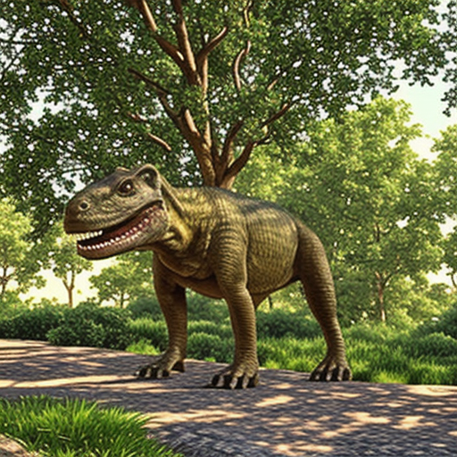
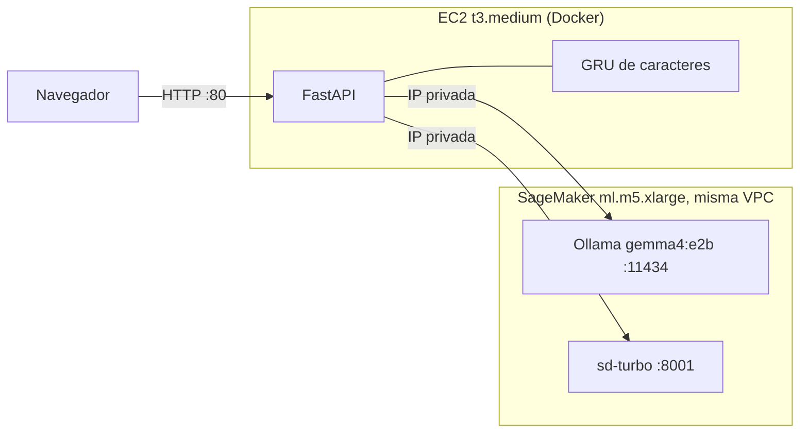
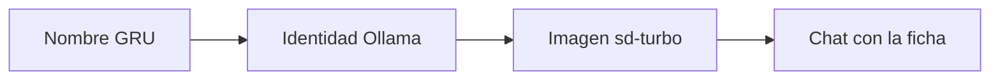
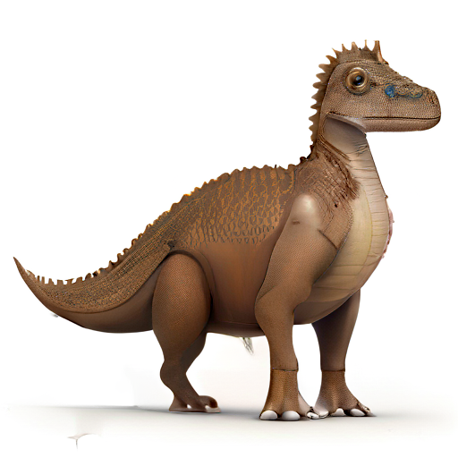
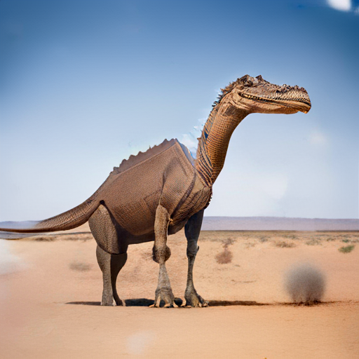
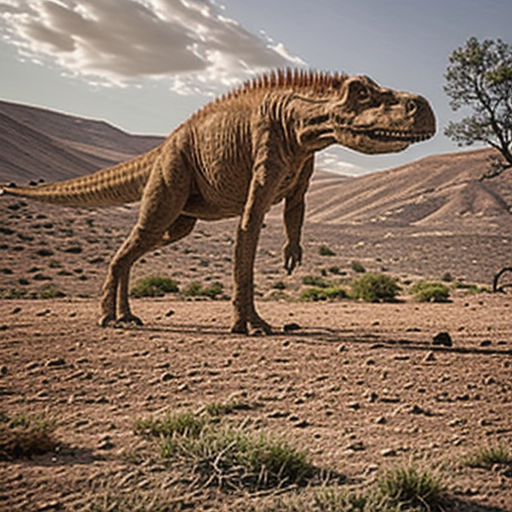

# LabDino

App que inventa un dinosaurio: genera su nombre con una red recurrente de caracteres, le pide una ficha a un LLM local, crea su retrato con un modelo de difusión y permite conversar con él.

Laboratorio II de Procesamiento de Lenguaje Natural, Universidad Sergio Arboleda, 2026 S02 · [Guía del laboratorio](docs/guia_laboratorio.pdf)

**Sitio:** http://184.73.83.84 (AWS Academy: solo responde mientras el Learner Lab está activo) · **Detalle de cada componente:** [docs/componentes.md](docs/componentes.md)

<table>
<tr>
<td width="200"></td>
<td>

**Doractodon**, el dinosaurio entregado.

| Campo | Valor |
|---|---|
| Nombre | generado por la GRU (no está en el dataset) |
| Aspecto | reptil robusto mediano, verde oliva |
| Rasgo distintivo | placa ósea iridiscente a lo largo del lomo |
| Hábitat | pantanos tropicales húmedos |
| Dieta | herbívora, solitaria |

Ficha completa: [ollama/identity.md](ollama/identity.md)

</td>
</tr>
</table>

## 1. Recorrido paso a paso

Un ejemplo de punta a punta con datos reales del repo.

**a) Dato.** `data/dinos.csv` tiene un nombre por línea, por ejemplo `Aardonyx`. Se pasa a minúsculas y sin espacios en los bordes: `aardonyx`.

**b) Tokenización.** Cada carácter pasa a un número (su id en el vocabulario). Se añaden `<SOS>` (inicio), `<EOS>` (fin) y `<PAD>` (relleno para que todas las secuencias midan igual).

| Posición | 0 | 1 | 2 | 3 | 4 | 5 | 6 | 7 | 8 | 9 | 10 ... 27 |
|---|---|---|---|---|---|---|---|---|---|---|---|
| Token | `<SOS>` | a | a | r | d | o | n | y | x | `<EOS>` | `<PAD>` |
| Id | 1 | 3 | 3 | 20 | 6 | 17 | 16 | 27 | 26 | 2 | 0 |

**c) Par entrada/salida.** `X` es la secuencia sin el último token y `Y` es la misma secuencia corrida una posición. En cada posición la red recibe el carácter de `X` y debe adivinar el de `Y`:

```
X = 1  3  3  20  6  17  16  27  26  2 ...   (<SOS> a a r d o n y x <EOS>)
Y = 3  3  20  6  17  16  27  26  2  0 ...   (a a r d o n y x <EOS> <PAD>)
```

**d) Qué predice la GRU.** Para cada posición produce 29 puntuaciones (una por token). Con `softmax` se vuelven probabilidades del siguiente carácter. Entrenar es hacer que la probabilidad del carácter correcto suba.

**e) Cómo sale `doractodon`.** Se empieza con `<SOS>`. La red da probabilidades, se sortea un carácter (con temperatura 1.0 y top-p 0.9), ese carácter se devuelve como entrada y se repite: `d`, `o`, `r`, `a`, `c`, `t`, `o`, `d`, `o`, `n`, `<EOS>`. Si el nombre coincide con uno del dataset se descarta y se sortea otro.

**f) Ollama.** El nombre entra en un prompt y `gemma4:e2b` devuelve un JSON con 7 claves. Resumen de [ollama/identity.json](ollama/identity.json):

```
apariencia, habitat, alimentacion, comportamiento   -> texto de la ficha
caracteristica_distintiva : "Una placa ósea calcificada de color iridiscente emerge a lo largo del lomo dorsal ..."
resumen_visual   : "Reptil robusto de tamaño medio, de color verde oliva, con una placa ósea
                    iridiscente visible a lo largo de su lomo dorsal."
visual_prompt_en : "A dinosaur, robust medium-sized reptile, olive green color,
                    with an iridescent bone plate along its dorsal spine."
```

**g) Prompt de imagen.** Se arma con el nombre y los rasgos de Ollama, como pide la guía: `Doractodon, a fictional dinosaur species:` + `visual_prompt_en` + un estilo fijo: *wildlife photograph, photorealistic, National Geographic, full body, wide shot, side view, in its natural habitat, natural daylight, realistic skin texture*. Queda guardado en [image_generator/outputs/doractodon.json](image_generator/outputs/doractodon.json).

**h) Imagen.** `sd-turbo` (4 pasos, 512x512) produce `doractodon.png`; la semilla elegida (4) está en el mismo json. El prompt real guardado es: *Doractodon, a fictional dinosaur species: A dinosaur, robust medium-sized reptile, olive green color, with an iridescent bone plate along its dorsal spine, wildlife photograph, photorealistic, National Geographic, full body, wide shot, side view, in its natural habitat, natural daylight, realistic skin texture*.

**i) Chat.** Cada mensaje a Ollama lleva la ficha como mensaje de sistema con la orden de no contradecirla. Si el usuario pide que se presente o se describa, la respuesta incluye la imagen.

## 2. Arquitectura



Flujo de **Nuevo Dinosaurio**, sin reentrenar:



No se usa ngrok en el despliegue final; la EC2 llega a SageMaker por la IP privada con un security group compartido.

## 3. Los datos

[`data/dinos.csv`](data/dinos.csv) es una lista de nombres de dinosaurios, uno por línea (copia de [jpospinalo/MachineLearning](https://github.com/jpospinalo/MachineLearning/blob/main/nlp/dinos.csv)).

| Dato | Valor |
|---|---|
| Líneas del archivo | 1536 |
| Nombres tras normalizar, quitar vacíos y duplicados | 1524 |
| Longitud (caracteres) | mín. 3, máx. 26, media 11.96, mediana 12 |
| Nombres que terminan en -saurus | 706 |
| Vocabulario | 29 tokens: `<PAD>`=0, `<SOS>`=1, `<EOS>`=2 y las letras a-z (ids 3 a 28) |
| T (longitud de secuencia) | 27 |
| Partición | 90 % entrenamiento (1372), 10 % validación (152), semilla 42 |

T sale del nombre más largo (26 letras) más `<SOS>` y `<EOS>`, menos 1 porque `X` e `Y` pierden un token cada uno. El conjunto de validación sirve para medir si la red generaliza a nombres que no vio.

## 4. Modelo de caracteres

**Formulación.** Un nombre es una secuencia de caracteres $x_1,\dots,x_n$. El modelo de lenguaje aprende a predecir el siguiente carácter dado los anteriores:

$$p(x_t \mid x_{<t}) = \text{softmax}(W h_t + b)$$

donde $h_t$ es el estado oculto de la GRU (una celda recurrente que resume lo leído hasta $t$). La pérdida es la entropía cruzada, que castiga dar poca probabilidad al carácter correcto, y se ignora en las posiciones `<PAD>`:

$$\mathcal{L} = -\frac{1}{|\mathcal{M}|}\sum_{t \in \mathcal{M}} \log p(y_t \mid x_{\le t}), \qquad \mathcal{M} = \{t : y_t \neq \texttt{<PAD>}\}$$

**Arquitectura.** `Embedding` (cada id pasa a un vector de 32 números) → GRU → capa lineal de 29 salidas. Optimizador Adam, lr 0.003, batch 64, CPU, semilla 42. *Early stopping* con paciencia 10: se detiene si la pérdida de validación no mejora en 10 épocas, y se guarda la mejor época.

**Comparación de dos configuraciones** (mismo split, batch y lr; [evidence/training_summary.md](evidence/training_summary.md)):

| | A | B (elegida) |
|---|---|---|
| Capas · hidden · dropout | 1 · 128 · 0.0 | 2 · 256 · 0.2 |
| Parámetros | 66 877 | 625 853 |
| Épocas corridas | 23 | 18 |
| Mejor época | 13 | 8 |
| Mejor pérdida de validación | 1.5716 | **1.5589** |
| Pérdida de entrenamiento final | 1.0913 | 0.8045 |


**Criterio de selección** (fijado antes de entrenar): menor pérdida de validación. B gana por 0.013, una diferencia pequeña. B se sobreajusta antes: su pérdida de entrenamiento baja mucho más (0.80 frente a 1.09) mientras la de validación apenas se mueve. El dropout reduce ese efecto pero no lo quita.

## 5. Muestreo

Al generar, el modelo da una distribución $p_i$ sobre los 29 tokens y hay que elegir uno.

- **Temperatura $T$:** $p_i = \text{softmax}(z_i / T)$. Con $T<1$ la distribución se afila (más repetición), con $T>1$ se aplana (más ruido).
- **Top-k:** solo se sortea entre los $k$ tokens más probables.
- **Top-p:** solo se sortea entre los tokens más probables cuya probabilidad acumulada llega a $p$.

Se compararon seis estrategias con 1000 muestras cada una ([evidence/generated_names.md](evidence/generated_names.md)):

| Estrategia | Copias del dataset | Repetidos | Longitud media | < 3 caracteres |
|---|---|---|---|---|
| T=0.5 | 7.0 % | 14.5 % | 11.57 | 0.0 % |
| T=1.0 | 1.0 % | 0.2 % | 11.97 | 0.2 % |
| T=1.5 | 0.1 % | 0.3 % | 13.15 | 0.8 % |
| top-k=5 | 4.4 % | 7.6 % | 11.63 | 0.0 % |
| top-k=3 | 10.7 % | 38.4 % | 11.50 | 0.0 % |
| **top-p=0.9 (T=1.0)** | 1.2 % | 1.1 % | 11.65 | 0.0 % |

Se eligió top-p=0.9 con T=1.0: copia poco, repite poco y no genera nombres degenerados. T=1.0 puro copia menos, pero a veces da nombres de menos de 3 caracteres.

Los 10 nombres entregados: Alapentosaurus, Salimimus, Gatarisaurus, **Doractodon**, Kematentaceratops, Revecterris, Mamusaurus, Sauroreptor, Yadanoceratops, Drachyrosuchus. Ninguno está en el dataset. Se eligió Doractodon por ser pronunciable y de longitud moderada.

Limitación: la novedad se mide solo por coincidencia exacta con el dataset, así que un nombre muy parecido a uno real también cuenta como nuevo.

## 6. Identidad con Ollama

Ollama sirve modelos de lenguaje en local. Se usa `gemma4:e2b` en Docker dentro del notebook de SageMaker; nombre, digest y versión (Ollama 0.40.8) quedaron registrados desde la instancia en [ollama/model_info.md](ollama/model_info.md), y la prueba de que responde está en [sagemaker/ollama_sagemaker_ejecutado.ipynb](sagemaker/ollama_sagemaker_ejecutado.ipynb). La ficha de Doractodon se generó en SageMaker con Ollama 0.40.8 (semilla 44, 165 palabras, 480 s), como muestra [sagemaker/ollama_sagemaker_ejecutado.ipynb](sagemaker/ollama_sagemaker_ejecutado.ipynb). Prompt completo en [ollama/identity_prompt.md](ollama/identity_prompt.md).

- **Esquema JSON** enviado en el parámetro `format`, con 7 claves: `apariencia`, `habitat`, `alimentacion`, `comportamiento`, `caracteristica_distintiva`, `resumen_visual`, `visual_prompt_en`.
- **Un solo rasgo distintivo**, con la misma ubicación anatómica en los tres campos que lo mencionan.
- **Validaciones:** JSON parseable, claves completas, campos no vacíos y entre 120 y 230 palabras (se pide 150 a 200). Genera advertencias si menciona especies reales, si la ubicación del rasgo cambia entre campos o si el nombre propio aparece en el prompt de imagen.
- **Semillas:** se prueban 42, 43 y 44 y se conserva la primera ficha sin advertencias. La 42 dio una advertencia (ubicación anatómica poco clara). La 43 salió limpia, con 176 palabras, y es la elegida.

## 7. Imagen

Se compararon tres opciones con Doractodon, semilla 0, en CPU ([evidence/imagen_comparativa](evidence/imagen_comparativa/README.md)); esta comparativa y la verificación de la sección 9 se hicieron con la versión anterior de la ficha (reptil pardo de zona árida):

<table>
<tr>
<td align="center"><br><sub>amused-512, 12 pasos, ~55 s</sub></td>
<td align="center"><br><sub>amused-512, 24 pasos, ~94 s</sub></td>
<td align="center"><br><sub>sd-turbo, 4 pasos, ~37-45 s</sub></td>
</tr>
</table>

Se eligió `stabilityai/sd-turbo` porque:

- da aspecto de fotografía, mientras amused-512 sale caricaturesco o con textura artificial;
- tiene un tamaño parecido (~1B de parámetros), como pide la guía;
- es un modelo destilado que funciona en CPU con 1 a 4 pasos y guidance 0.

Prompt usado: el `visual_prompt_en` de la ficha más el estilo fotográfico del paso 1g. El prompt negativo (*cartoon, illustration, drawing, ...*) solo se registra en el JSON porque con guidance 0 no tiene efecto.

## 8. App y chat

FastAPI ([`app/server.py`](app/server.py)) sirve la interfaz ([`app/static/index.html`](app/static/index.html)). Payloads completos en [docs/componentes.md](docs/componentes.md).

| Endpoint | Función |
|---|---|
| `GET /api/info` | Datos del modelo de nombres |
| `GET /api/dino` | Dinosaurio actual |
| `POST /api/dino/new` | Nombre, ficha e imagen nuevos, sin reentrenar |
| `POST /api/chat` | Respuesta del dinosaurio; `image_url` solo si se pide presentarse o describirse |
| `GET /images/{dino_id}.png` | Retrato |

## 9. Verificación de la guía

Pruebas hechas el 2026-10-22 sobre el sitio desplegado. Detalle y tiempos en [evidence/verificacion_entrega.md](evidence/verificacion_entrega.md).

| Ítem de la guía | Estado | Evidencia breve |
|---|---|---|
| Diez nombres no son copias | ✅ | ninguno está en `dinos.csv` (1524 nombres) |
| Identidad coherente | ✅ | hábitat, cuerpo, dieta y conducta concuerdan |
| Imagen corresponde a los rasgos | ⚠️ | cuerpo, color y entorno sí; el rasgo pequeño no siempre se ve |
| Chat conserva la identidad | ✅ | 5 turnos; ante "ahora eres un T-rex" respondió que seguía siendo el mismo dinosaurio |
| Imagen al presentarse o describirse | ✅ | "Preséntate" y "Descríbete" devuelven imagen; "¿Qué comes?" no |
| Nuevo Dinosaurio sin reentrenar | ✅ | el servidor solo hace inferencia; mismo `model.pt` (sha256 idéntico al del repo) |
| Sitio accesible | ✅ | `GET /` 200 en 0.26 s |
| Repo sin información sensible | ✅ | búsqueda de tokens y claves sin resultados; `.env` ignorado |

## 10. Cómo ejecutar

Requisitos: [uv](https://docs.astral.sh/uv/), Python 3.12 y un Ollama accesible con `ollama pull gemma4:e2b`.

```bash
uv sync && uv run pytest                      # dependencias y pruebas
cp .env.example .env                          # completar OLLAMA_BASE_URL, OLLAMA_MODEL, IMAGE_API_URL
set -a; source .env; set +a
uv run uvicorn app.server:app --port 8000     # abrir http://localhost:8000
```

Reentrenar y regenerar `evidence/` y `name_generator/artifacts/` (unos 20 s en CPU, determinista):

```bash
uv run jupyter nbconvert --to notebook --execute --inplace name_generator/train_and_evaluate.ipynb
```

Generar la ficha: `uv run python ollama/generate_identity.py`.

**Despliegue en AWS.** El script [`sagemaker/on-start.sh`](sagemaker/on-start.sh) levanta Ollama y el servidor de imágenes en el notebook `ml.m5.xlarge` (volumen de al menos 30 GB). La EC2 usa [`deploy/ec2_user_data.sh`](deploy/ec2_user_data.sh) con el puerto 80 abierto, y las variables van en `/opt/labdino.env` (luego `docker restart labdino`). Antes de construir la imagen Docker, `image_generator/outputs/` debe contener `doractodon.png`.

**Variables** (plantilla en [`.env.example`](.env.example)):

| Variable | Descripción | Por defecto |
|---|---|---|
| `OLLAMA_BASE_URL` | URL base de Ollama | obligatoria |
| `OLLAMA_MODEL` | Modelo a usar | obligatoria |
| `IMAGE_API_URL` | URL del servidor de imágenes; vacía = sin imagen nueva | vacía |
| `OLLAMA_CONNECT_TIMEOUT` / `OLLAMA_READ_TIMEOUT` | Esperas en segundos | `5` / `300` |
| `OLLAMA_IDENTITY_THINK` / `OLLAMA_CHAT_THINK` | Razonamiento del modelo en ficha / chat | `true` / `false` |
| `IMAGE_TIMEOUT` | Espera de la imagen en segundos | `300` |
| `*_NGROK_SKIP_WARNING` | Cabecera para túneles ngrok | `false` |

**Estructura**

```
src/labdino/       preprocesamiento, modelo, entrenamiento, muestreo, cliente Ollama, chat
name_generator/    notebook de entrenamiento y artifacts/ (lo único que carga el backend)
ollama/            prompt, scripts y ficha generada
image_generator/   generador y servidor de imágenes
sagemaker/         on-start.sh y notebook de verificación
app/  deploy/      backend, interfaz, Dockerfile y user data de la EC2
evidence/  docs/   resultados del entrenamiento, muestreo, imágenes y verificación
data/  tests/      dinos.csv y pruebas con pytest
```

## 11. Limitaciones

- **Lentitud en CPU.** Nuevo Dinosaurio tardó 466.9 s la primera vez (arranque en frío) y 248.6 s la segunda. El chat responde en 5 a 20 s. Hay que avisarlo en la demostración.
- **Imagen aproximada.** sd-turbo no siempre dibuja el rasgo distintivo; en Doractodon la placa iridiscente del lomo no se distingue con claridad en la imagen.
- **IP pública.** Cambia al reiniciar la EC2, y hay que actualizar el enlace del sitio. Si cambia la IP privada del notebook, se edita `/opt/labdino.env`.
- **Diferencia entre A y B.** Es pequeña (0.013 en pérdida de validación) y viene de una sola partición y una sola semilla.
- **Novedad de nombres.** Se mide solo por coincidencia exacta con el dataset.
