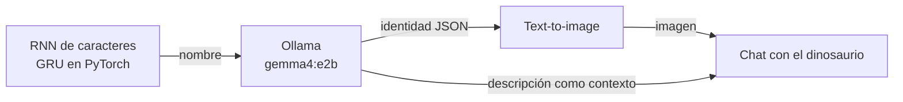
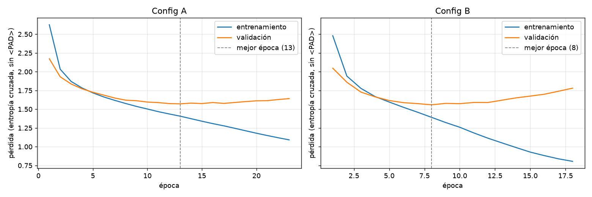

# 🦖 LabDino

**Una app que inventa un dinosaurio: le da nombre, le escribe una ficha científica, le pinta un retrato y te deja conversar con él.**

Laboratorio II de Procesamiento de Lenguaje Natural · Universidad Sergio Arboleda · 2026 S02
([guía del laboratorio](docs/guia_laboratorio.pdf))



**Sitio web:** http://54.211.115.130 (AWS Academy: solo responde mientras el Learner Lab está activo) · Documentación de cada componente (qué recibe y qué devuelve): [docs/componentes.md](docs/componentes.md)

## Ejemplo

El modelo de caracteres propone un nombre nuevo, que no está en el dataset, y Ollama construye la especie:

> **Doractodon** — *Este dinosaurio es un animal de tamaño mediano, de color marrón terroso, con una postura erguida y
> una protuberancia cónica en la parte superior del hocico que modifica su dentición.*
> Hábitat: llanuras áridas y matorrales semiáridos · Dieta: herbívora especializada · Carácter: solitario y cauteloso.

Ficha completa en [ollama/identity.md](ollama/identity.md).

## Inicio rápido

Requisitos: [uv](https://docs.astral.sh/uv/) y Python 3.12. Para la parte de identidad, un [Ollama](https://ollama.com/) accesible
con el modelo descargado (`ollama pull gemma4:e2b`).

```bash
uv sync                                  # instala dependencias (PyTorch, httpx, pytest, jupyterlab…)
uv run pytest                            # 74 tests; uno más, contra Ollama real, se omite sin variables de entorno
```

Para la app completa ver [Ejecutar la app localmente](#ejecutar-la-app-localmente).

**Generar un nombre sin reentrenar** (usa los artefactos versionados):

```python
from pathlib import Path
from labdino.artifacts import load_artifacts, generate_novel_name

art = load_artifacts(Path("name_generator/artifacts"))
print(generate_novel_name(art).capitalize())   # p. ej. "Teratonia"; cada llamada usa una semilla distinta
```

**Generar la identidad** (necesita Ollama):

```bash
cp .env.example .env                     # completa OLLAMA_BASE_URL y OLLAMA_MODEL
set -a; source .env; set +a              # el repo no lee .env por sí solo
uv run python ollama/generate_identity.py
```

## Componentes

| Ruta | Qué hay |
|---|---|
| [`src/labdino/`](src/labdino) | Código compartido que usan el notebook y el backend |
| [`name_generator/`](name_generator) | Notebook de entrenamiento y evaluación + [`artifacts/`](name_generator/artifacts) (lo único que carga el backend) |
| [`ollama/`](ollama) | Registro del modelo, prompt de identidad, scripts y la ficha generada |
| [`sagemaker/`](sagemaker) | `on-start.sh` (lifecycle: Docker con `data-root` persistente, Ollama, ngrok opcional) y `ollama_sagemaker.ipynb` (verificación) |
| [`image_generator/`](image_generator) | `generate_image.py`, `colab_image_server.ipynb` (servidor de imágenes con ngrok), `requirements.txt` |
| [`app/`](app) | `server.py` (FastAPI: chat y Nuevo Dinosaurio) y `static/index.html` (interfaz) |
| [`deploy/`](deploy) | `Dockerfile` y `ec2_user_data.sh` para desplegar la app en EC2 |
| [`docs/`](docs) | Guía del laboratorio y [componentes.md](docs/componentes.md) |
| [`evidence/`](evidence) | Curvas de pérdida, resumen de entrenamiento, configuraciones de muestreo, 10 nombres y su análisis |
| [`data/`](data) | `dinos.csv` |
| [`tests/`](tests) | Pruebas con `pytest` |

Módulos principales de `src/labdino/`:

| Módulo | Responsabilidad |
|---|---|
| `preprocessing` | Normalización, vocabulario, tokens `<PAD>/<SOS>/<EOS>`, T y pares X/Y desplazados |
| `model`, `training` | `CharRNN` (Embedding → RNN/LSTM/GRU → Linear), pérdida sin `<PAD>`, split y bucle con early stopping |
| `sampling` | Muestreo autoregresivo con temperatura, top-k y top-p; métricas de novedad |
| `artifacts` | Guardar y cargar el modelo para generar nombres sin reentrenar |
| `ollama_client`, `identity` | Cliente HTTP de Ollama; prompt, esquema JSON, validación y reintentos de la ficha |
| `chat` | Prompt de sistema con la ficha, saludo y detección de peticiones que llevan imagen |
| `image_client` | Cliente HTTP del servidor de imágenes y construcción del prompt visual |

## Cómo funciona

### 1. Generador de nombres

Un modelo de lenguaje a nivel de carácter aprende a predecir la siguiente letra de un nombre de dinosaurio y, al generar,
usa cada carácter producido como entrada del siguiente paso (autoregresivo).

- **Datos:** [`data/dinos.csv`](data/dinos.csv), copia de [jpospinalo/MachineLearning](https://github.com/jpospinalo/MachineLearning/blob/main/nlp/dinos.csv).
  Normalizado quedan 1524 nombres, vocabulario de 29 tokens y T = 27.
- **Preprocesamiento:** secuencias `[<SOS>, c₁…cₙ, <EOS>]` rellenadas con `<PAD>`; entrada `X = [x₀…x_{T-1}]`, objetivo `Y = [x₁…x_T]`.
- **Entrenamiento:** Adam, entropía cruzada que ignora `<PAD>`, CPU y semilla 42. Dos configuraciones con el mismo split (90/10), batch y
  learning rate, y early stopping sobre la pérdida de validación. Se guarda el checkpoint de la **mejor** época, no el último.

| Config | Arquitectura | Parámetros | Mejor val loss | Mejor época |
|---|---|---|---|---|
| A | GRU · 1 capa · hidden 128 | 66 877 | 1.5716 | 13 |
| **B** (elegida) | GRU · 2 capas · hidden 256 · dropout 0.2 | 625 853 | **1.5589** | 8 |

La configuración se eligió por menor pérdida de validación, criterio fijado antes de entrenar. B gana por poco y se sobreajusta antes:



- **Muestreo:** se compararon seis estrategias con 1000 muestras cada una (copias del dataset, repetidos, longitud, nombres cortos).
  Se usa **top-p = 0.9 con temperatura 1.0**: casi no copia nombres reales (1.2 %), apenas repite (1.1 %) y no produce nombres degenerados.
  Detalle y análisis en [evidence/generated_names.md](evidence/generated_names.md).
- **Novedad:** un nombre solo se acepta si no coincide, con la misma normalización, con ninguno de los 1524 del dataset
  (`train_names.txt` viaja con los artefactos).

Los 10 nombres entregados: Alapentosaurus, Salimimus, Gatarisaurus, **Doractodon** (elegido), Kematentaceratops, Revecterris,
Mamusaurus, Sauroreptor, Yadanoceratops y Drachyrosuchus.

### 2. Identidad con Ollama

El nombre elegido pasa a un LLM local (`gemma4:e2b`, Ollama 0.40.6; versiones exactas en [ollama/model_info.md](ollama/model_info.md)).

- **Prompt** ([ollama/identity_prompt.md](ollama/identity_prompt.md)): pide apariencia, hábitat, alimentación, comportamiento y un único rasgo
  físico distintivo, con pistas de sufijos reales (-saurus, -raptor, -odon, -venator) como orientación y no como plantilla.
  Exige rasgos coherentes entre sí y una especie inventada.
- **Salida estructurada:** JSON con claves fijas (el esquema se envía en el parámetro `format`), 150–200 palabras, más `visual_prompt_en`,
  una frase en inglés pensada para el generador de imágenes.
- **Validación automática:** reintenta si el JSON no parsea, faltan claves, hay campos vacíos o la longitud se sale de 120–230. Avisa si aparecen
  nombres de especies reales, si la ubicación del rasgo no coincide entre campos o si el nombre propio se cuela en el prompt de imagen.
- **Semillas:** prueba 42, 43 y 44 y conserva la primera ficha sin advertencias. La elegida y el motivo quedan en
  [ollama/identity.json](ollama/identity.json), junto con el prompt, el modelo, los parámetros y la fecha.

### 3. Imagen

`amused/amused-512` (diffusers) genera un retrato 512x512 a partir de `visual_prompt_en` de la ficha más un estilo fijo (sin el nombre propio).

- **Script:** `image_generator/generate_image.py` lee `ollama/identity.json` y guarda `image_generator/outputs/<nombre>.png` y un `.json` con prompt, semilla y parámetros.
  Usa GPU si hay; en CPU funciona pero tarda.
- **Colab:** `image_generator/colab_image_server.ipynb` genera la imagen de Doractodon y levanta un servidor `POST /generate` expuesto con ngrok
  (token en los *Secrets* de Colab como `NGROK_TOKEN`).
- La app pide la imagen **una sola vez** por dinosaurio y la reutiliza en el chat.

### 4. App web y chat

FastAPI ([`app/server.py`](app/server.py)) sirve la interfaz ([`app/static/index.html`](app/static/index.html)) y conecta todo el flujo.

- **Inicio:** muestra a Doractodon (ficha de `ollama/identity.json` e imagen de `image_generator/outputs/`), con nombre, descripción, imagen e información del modelo de nombres.
- **Chat:** cada petición a Ollama lleva la ficha como mensaje de sistema, con la regla de no contradecirla. Si el usuario pide que se presente o se describa, la respuesta incluye la imagen.
- **Nuevo Dinosaurio:** el modelo ya entrenado genera otro nombre, Ollama crea la ficha y se pide la imagen; no se reentrena. Sin `IMAGE_API_URL` la app funciona sin imagen nueva.
- Endpoints y payloads: [docs/componentes.md](docs/componentes.md).

## Ejecutar la app localmente

Necesita un Ollama accesible y, opcionalmente, el servidor de imágenes (si no, el dinosaurio nuevo queda sin imagen).

```bash
cp .env.example .env                     # completa OLLAMA_BASE_URL, OLLAMA_MODEL e IMAGE_API_URL
set -a; source .env; set +a
uv run uvicorn app.server:app --host 0.0.0.0 --port 8000
```

Abrir <http://localhost:8000>. Con `uv sync` ya se instalan las dependencias de `src/labdino`; si falta FastAPI o uvicorn, `uv pip install fastapi uvicorn`.

## Despliegue

Orden: SageMaker → Colab → EC2. Las URLs de ngrok cambian cada vez que se reinicia un túnel y no se versionan.

1. **SageMaker:** crear la *lifecycle configuration* on-start con `sagemaker/on-start.sh`, crear el notebook `ml.m5.xlarge` (volumen ≥ 30 GB) con ella y abrir `sagemaker/ollama_sagemaker.ipynb` para verificar Docker, el modelo y una respuesta.
2. **Token de ngrok en SageMaker:** guardarlo en `/home/ec2-user/SageMaker/.ngrok_token` (fuera de git) y reiniciar el notebook; la lifecycle abre el túnel al puerto 11434. Leer la URL en la última celda del notebook.
3. **Colab:** abrir `image_generator/colab_image_server.ipynb` con GPU T4, poner `NGROK_TOKEN` en *Secrets*, ejecutar todas las celdas y copiar la URL impresa (`IMAGE_API_URL`).
4. **EC2:** lanzar una instancia Amazon Linux 2023 con `deploy/ec2_user_data.sh` como user data y el puerto 80 abierto en el security group. Construye la imagen Docker y arranca la app.
5. **Variables:** en la instancia, escribir `/opt/labdino.env` con `OLLAMA_BASE_URL`, `OLLAMA_MODEL`, `OLLAMA_NGROK_SKIP_WARNING=true`, `IMAGE_API_URL` e `IMAGE_NGROK_SKIP_WARNING=true`, y reiniciar con `docker restart labdino`.
6. **Probar:** abrir la IP pública de la EC2 y recorrer la lista de verificación de abajo.

Estado: desplegado en AWS (**Sitio web:** http://54.211.115.130, AWS Academy: solo responde mientras el Learner Lab está activo).

**Arquitectura realmente usada:** el notebook SageMaker `labdino-ollama` (ml.m5.xlarge) en la VPC por defecto corre Ollama (gemma4:e2b, :11434) y el servidor de imágenes amused-512 en CPU (`image_generator/server.py` en Docker, :8001) mediante `sagemaker/on-start.sh`. La EC2 t3.medium `labdino-app` corre la app (:80) y los alcanza por IP privada con un security group compartido, sin ngrok. Colab/ngrok quedan como alternativa.

Para la sustentación: iniciar el Learner Lab, encender el notebook (Start) y la EC2. Si la IP pública de la EC2 cambia, actualizar el link; si cambia la IP privada del notebook, editar `/opt/labdino.env` y `docker restart labdino`.
El `Dockerfile` copia `image_generator/outputs/`, que debe contener `doractodon.png` antes de construir.

## Configuración

El repo no trae URLs ni credenciales. Las variables se leen del entorno (plantilla en [`.env.example`](.env.example); `.env` está en `.gitignore`):

| Variable | Descripción | Por defecto |
|---|---|---|
| `OLLAMA_BASE_URL` | URL base de Ollama | obligatoria |
| `OLLAMA_MODEL` | Modelo a usar | obligatoria |
| `OLLAMA_NGROK_SKIP_WARNING` | Añade la cabecera `ngrok-skip-browser-warning` | `false` |
| `OLLAMA_CONNECT_TIMEOUT` / `OLLAMA_READ_TIMEOUT` | Tiempos de espera en segundos | `5` / `300` |
| `OLLAMA_IDENTITY_THINK` | Razonamiento del modelo al crear la ficha | `true` |
| `OLLAMA_CHAT_THINK` | Razonamiento del modelo en el chat | `false` |
| `IMAGE_API_URL` | URL base del servidor de imágenes (Colab/ngrok); vacía = sin imagen nueva | vacía |
| `IMAGE_NGROK_SKIP_WARNING` | Añade la cabecera `ngrok-skip-browser-warning` | `false` |
| `IMAGE_TIMEOUT` | Tiempo de espera de la imagen en segundos | `300` |

Los errores de conexión, de modelo inexistente o de configuración indican qué variable revisar.

## Reproducir los resultados

```bash
# Reentrenar, evaluar, muestrear y regenerar evidence/ y name_generator/artifacts/ (≈20 s en CPU)
uv run jupyter nbconvert --to notebook --execute --inplace name_generator/train_and_evaluate.ipynb

# Regenerar el registro del modelo de Ollama (sirve también en SageMaker)
uv run python ollama/write_model_info.py

# Reescribir solo el prompt de identidad, sin llamar a Ollama
uv run python ollama/generate_identity.py --show-prompt
```

El entrenamiento es determinista: reproduce los mismos checkpoints y los mismos 10 nombres. El filtro `nbstripout` quita las salidas del
notebook al hacer commit.

### Artefactos del generador

| Archivo | Contenido |
|---|---|
| `model.pt` | Pesos de la mejor época de la configuración B |
| `vocab.json` | Vocabulario (el índice es el id) |
| `config.json` | Arquitectura, capas, hidden, dropout, T, ids especiales, muestreo por defecto y criterio de selección |
| `train_names.txt` | Los 1524 nombres normalizados, para rechazar copias |

Los checkpoints de A y B están en `evidence/checkpoints/` como evidencia.

## Hoja de ruta

- [x] Generador de nombres: entrenamiento, comparación de dos configuraciones, muestreo y artefactos
- [x] Identidad con Ollama en local
- [x] Ollama en SageMaker (`m5.xlarge`, Docker con `data-root` persistente y script `on-start`): implementado en código
- [x] Imagen con un modelo text-to-image a partir de la ficha: implementado en código
- [x] Aplicación web con el chat y el botón **Nuevo Dinosaurio**: implementada en código
- [x] Despliegue en AWS: sitio publicado en http://54.211.115.130

## Verificación antes de la entrega

- [x] Los diez nombres generados no son copias directas del conjunto de entrenamiento
- [x] El dinosaurio seleccionado tiene una identidad coherente
- [ ] La imagen corresponde con los rasgos descritos (aproximada: amused-512 no siempre dibuja el rasgo distintivo)
- [x] El chat conserva la identidad durante la conversación
- [x] La imagen aparece en el chat al presentar o describir al dinosaurio
- [x] El botón Nuevo Dinosaurio inicia una nueva generación sin reentrenar el modelo
- [x] El sitio web es accesible
- [x] El repositorio contiene las instrucciones necesarias y no publica información sensible
