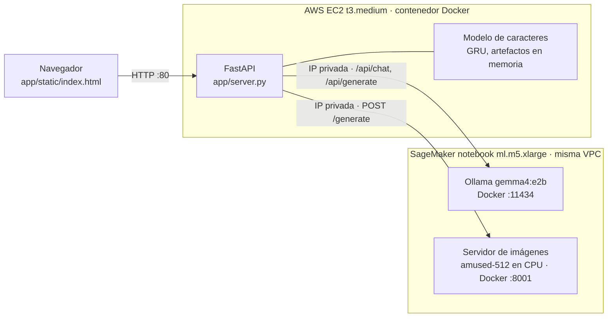

# Componentes: qué recibe y qué devuelve cada uno

Requisito de la [guía](guia_laboratorio.pdf) (sección 5): documentar la información que recibe y devuelve cada componente.

## Arquitectura desplegada



Flujo de *Nuevo Dinosaurio*: nombre (local, sin reentrenar) → identidad (Ollama) → imagen (Colab, una sola vez por dinosaurio) → chat (Ollama, con la ficha como contexto).
En el despliegue final la EC2 alcanza ambos servidores por la VPC privada (security group compartido), sin ngrok; se configuran con `OLLAMA_BASE_URL` e `IMAGE_API_URL` (ver [README](../README.md#configuración)). Colab/ngrok (URLs temporales) quedan como alternativa para el servidor de imágenes con el mismo contrato.

## Resumen por componente

| Componente | Dónde corre | Código | Recibe | Devuelve |
|---|---|---|---|---|
| Generador de nombres | Dentro del backend (CPU) | `src/labdino/artifacts.py`, `sampling.py` | Nada (semilla aleatoria) | Un nombre nuevo (`str`) que no está en el dataset |
| Ollama | SageMaker, Docker, puerto 11434 (VPC privada) | `sagemaker/`, cliente en `src/labdino/ollama_client.py` | JSON a `/api/generate` o `/api/chat` | JSON con el texto generado |
| Servidor de imágenes | SageMaker (CPU, Docker, puerto 8001, VPC privada); alternativa: Colab GPU vía ngrok | `image_generator/server.py`, `image_generator/colab_image_server.ipynb` | `POST /generate` con JSON | PNG (bytes) |
| Backend de la app | EC2, contenedor, puerto 8000 (expuesto en 80) | `app/server.py` | Peticiones del navegador | JSON e imágenes |
| Frontend | Navegador | `app/static/index.html` | Respuestas JSON del backend | Interfaz: ficha, retrato, chat, botón Nuevo Dinosaurio |

## Ollama (SageMaker)

API estándar de Ollama; el backend usa estos endpoints. Si la URL es de ngrok se añade la cabecera `ngrok-skip-browser-warning: true`.

| Endpoint | Recibe | Devuelve |
|---|---|---|
| `GET /api/version` | Nada | `{"version": "..."}` |
| `GET /api/tags` | Nada | `{"models": [{"name", "digest", "size", "details"}]}` |
| `POST /api/show` | `{"model": "gemma4:e2b"}` | Detalles del modelo |
| `POST /api/generate` | Ver abajo | `{"response": "...", ...}` |
| `POST /api/chat` | Ver abajo | `{"message": {"role": "assistant", "content": "..."}, ...}` |

Identidad (`/api/generate`; el campo `format` lleva el esquema JSON de la ficha):

```json
{"model": "gemma4:e2b", "prompt": "<prompt de ollama/identity_prompt.md con el nombre>", "stream": false,
 "format": {"type": "object", "...": "esquema con las claves de la ficha"}, "think": true,
 "options": {"seed": 42}}
```

`response` es un texto JSON con las claves: `apariencia`, `habitat`, `alimentacion`, `comportamiento`, `caracteristica_distintiva`, `resumen_visual`, `visual_prompt_en`.

Chat (`/api/chat`; la ficha viaja como mensaje `system` en cada petición):

```json
{"model": "gemma4:e2b", "stream": false, "think": false,
 "messages": [{"role": "system", "content": "Eres Doractodon... <ficha> ..."},
              {"role": "user", "content": "¿Qué comes?"}]}
```

## Servidor de imágenes (SageMaker; alternativa Colab)

Mismo contrato en ambos entornos.

| Endpoint | Recibe | Devuelve |
|---|---|---|
| `GET /health` | Nada | `{"ok": true, "model": "amused/amused-512"}` |
| `POST /generate` | `{"prompt": str, "seed": int \| null}` (el prompt se trunca a 400 caracteres) | `200 image/png` (512x512) |

Ejemplo:

```bash
curl -X POST "$IMAGE_API_URL/generate" -H "Content-Type: application/json" \
     -H "ngrok-skip-browser-warning: true" \
     -d '{"prompt": "a medium-sized brown dinosaur with a conical snout, full body, side view", "seed": 7}' -o dino.png
```

El prompt lo arma `build_image_prompt` (`src/labdino/image_client.py`): `visual_prompt_en` de la ficha + estilo fijo, sin el nombre propio.
Si el servidor falla, el backend devuelve el dinosaurio sin imagen y muestra el error.

## Backend de la app (EC2)

| Endpoint | Recibe | Devuelve |
|---|---|---|
| `GET /api/info` | Nada | `{"name_model": {"arquitectura", "capas", "hidden_size", "dropout", "T", "vocabulario", "muestreo", "seleccion", "nombres_entrenamiento"}}` |
| `GET /api/dino` | Nada | Dinosaurio actual (objeto abajo); 404 si no hay |
| `POST /api/dino/new` | Nada | Dinosaurio nuevo (objeto abajo); 409 si ya hay una generación en curso; 502 si falla Ollama |
| `POST /api/chat` | `{"dino_id": str, "messages": [{"role": "user"\|"assistant", "content": str}]}` (usa los últimos 20; el último debe ser `user`) | `{"reply": str, "image_url": str \| null}` |
| `GET /images/{dino_id}.png` | Nada | `image/png`; 404 si no existe |
| `GET /` | Nada | `index.html` |

Objeto dinosaurio:

```json
{"id": "doractodon", "name": "Doractodon",
 "identity": {"apariencia": "...", "habitat": "...", "alimentacion": "...", "comportamiento": "...",
              "caracteristica_distintiva": "...", "resumen_visual": "...", "visual_prompt_en": "..."},
 "meta": {"id": "...", "ollama_model": "gemma4:e2b", "seed": 42},
 "image_url": "/images/doractodon.png", "image_error": null, "greeting": "¡Hola! Soy Doractodon. ..."}
```

Detalles:

- `image_url` en `/api/chat` solo viene cuando el último mensaje pide presentarse o describirse (`wants_image` en `src/labdino/chat.py`); la imagen es siempre la misma, guardada en `app/data/images/`.
- *Nuevo Dinosaurio* usa el modelo ya entrenado (`generate_novel_name`) y semillas aleatorias para la identidad; no reentrena.
- Al arrancar, el dinosaurio inicial es Doractodon (`ollama/identity.json` + `image_generator/outputs/doractodon.png`).
- El estado vive en memoria: reiniciar el contenedor lo pierde.

## Generador de nombres (en el backend)

| | |
|---|---|
| Recibe | Artefactos de `name_generator/artifacts/` (`model.pt`, `vocab.json`, `config.json`, `train_names.txt`); ninguna entrada en tiempo de ejecución |
| Devuelve | Un nombre en minúsculas (el backend lo capitaliza), con top-p 0.9 y temperatura 1.0, rechazando coincidencias con el dataset |
